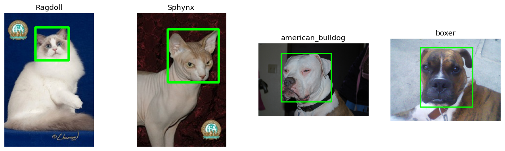

# Лабораторная 1. Среда, данные и первая сводка

**Задача.** Научиться загружать изображения, работать с ними как с массивами через OpenCV и собирать сводку по датасету.

**Как запустить.** Работал(а) в Google Colab. Для запуска нужно открыть `starter.ipynb` с GitHub, сохранить копию на Диск, в первой ячейке выставить `VARIANT = 20` и нажать «Выполнить всё».

**Данные.** Вариант 20. Породы из `variant.json`: Ragdoll, Sphynx, american_bulldog, boxer. Всего 806 файлов (404 кошки и 402 собаки).

**Результаты.** 
Основные числа:
| Метрика | Значение |
| :--- | :--- |
| Всего файлов | 806 |
| Породы | 4 |
| Кошки | 404 |
| Собаки | 402 |
| Мин. ширина | 161 |
| Медиана ширины | 500 |
| Макс. ширина | 1075 |
| Не RGB | 0 |
| Фейковые JPEG | 0 |
| Есть XML (боксы) | 403 |

Сетка примеров:

**Выводы.**
1. В датасете нет проблемных файлов (0 не RGB и 0 фейковых JPEG), но если бы они были, OpenCV по умолчанию превратил бы их в 3 канала.
2. Разметка есть у 403 файлов из 806 (примерно 50%). 
3. Разброс размеров очень большой: от 161x168 до 1075x901. При ресайзе сильно вытянутые фото исказятся.
4. OpenCV отдает массив в порядке BGR, поэтому без `cv2.cvtColor` кошка на фото становится синей.
